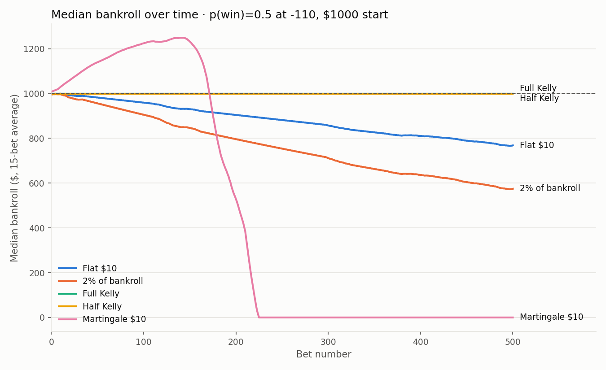
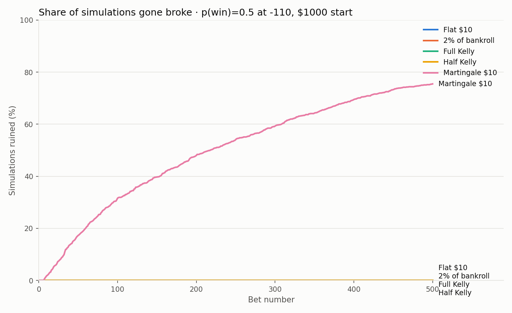
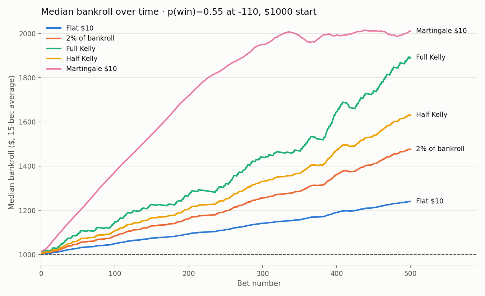
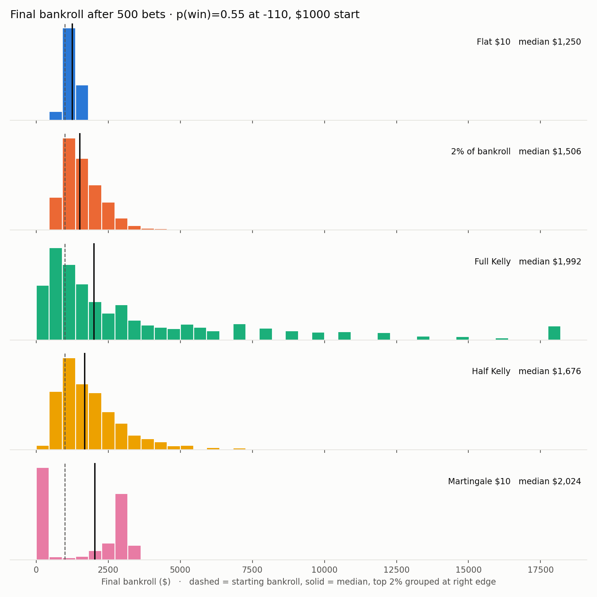

# Monte-Carlo-Simulator

Simulates sports betting bankrolls with Monte Carlo methods to see how odds, win probability, and bet sizing affect long-run results.

Instead of solving for outcomes with formulas, the simulator plays out thousands of betting sequences with random results and measures what happens: how often you profit, how often you go broke, and how big the swings get along the way.

## Key findings

1. **No bet sizing strategy beats a negative edge.** At a 50% win rate against -110 odds, every strategy that bets loses money over time. The sportsbook's cut costs about $0.45 per $10 bet.
2. **Martingale feels like winning until it doesn't.** Doubling after losses produces lots of small wins, then a losing streak wipes out the bankroll. With no edge, 75.5% of simulations went broke.
3. **Kelly sizing maximizes growth but brings big swings.** With a 55% win rate, full Kelly had the highest typical result, but the average simulation fell 67% from its peak at some point. Half Kelly kept most of the growth with much smaller drawdowns.
4. **The mean can be misleading.** Full Kelly's mean final bankroll ($3,549) is far above its median ($1,992) because a few simulations grew huge. The median describes the typical outcome better.

## Results

All results use a $1,000 starting bankroll, -110 odds, 500 bets per simulation, and 1,000 simulations per strategy (seed 42).

### Strategies compared

| Strategy | How it sizes bets |
|---|---|
| Flat $10 | Same $10 every bet |
| 2% of bankroll | 2% of current bankroll (minimum $1) |
| Full Kelly | Kelly criterion fraction of bankroll: f = (b·p − q) / b |
| Half Kelly | Half the Kelly fraction |
| Martingale $10 | Starts at $10, doubles after each loss, resets after a win |

### No edge: 50% win rate

| Strategy | Mean | Median | Chance of profit | Risk of ruin | Avg max drawdown |
|---|---:|---:|---:|---:|---:|
| Flat $10 | $766 | $773 | 14.8% | 0.0% | 36.3% |
| 2% of bankroll | $627 | $579 | 9.5% | 0.0% | 54.3% |
| Full Kelly | $1,000 | $1,000 | 0.0% | 0.0% | 0.0% |
| Half Kelly | $1,000 | $1,000 | 0.0% | 0.0% | 0.0% |
| Martingale $10 | $548 | $0 | 22.6% | 75.5% | 88.8% |

Kelly never bets here: with no edge, the formula gives a bet size of zero.





### With an edge: 55% win rate

| Strategy | Mean | Median | Chance of profit | Risk of ruin | Avg max drawdown |
|---|---:|---:|---:|---:|---:|
| Flat $10 | $1,240 | $1,250 | 88.6% | 0.0% | 15.6% |
| 2% of bankroll | $1,608 | $1,506 | 81.5% | 0.0% | 31.5% |
| Full Kelly | $3,549 | $1,992 | 71.1% | 0.0% | 66.8% |
| Half Kelly | $1,916 | $1,676 | 79.2% | 0.0% | 40.9% |
| Martingale $10 | $1,530 | $2,024 | 54.2% | 44.0% | 68.9% |

Martingale's median looks best, but 44% of its simulations went broke. Most runs either grew steadily or lost everything.





More charts are in [`figures/`](figures/).

### Metric definitions

- **Chance of profit**: share of simulations that ended above the starting bankroll.
- **Risk of ruin**: share of simulations that ended unable to cover the minimum bet.
- **Max drawdown**: the largest drop from a high point to a later low point, as a percentage of the high. "Avg max drawdown" averages this across simulations.

## Setup

```
pip install -r requirements.txt
```

## Usage

Run commands from the project root.

```
python -m experiments.run_baseline         # baseline report for flat betting
python -m experiments.compare_strategies   # strategy comparison tables
python -m experiments.make_figures         # save charts to figures/
python -m pytest                           # run the tests
```

## Project layout

- `src/odds.py` – converts moneyline odds to a return multiplier
- `src/simulate.py` – single bet, bet sequence, and Monte Carlo simulation
- `src/strategies.py` – bet sizing strategies (flat, percent, Kelly, Martingale)
- `src/metrics.py` – summary statistics for simulation results
- `src/plots.py` – chart functions
- `experiments/` – scripts that run simulations and make charts
- `figures/` – generated charts
- `tests/` – unit tests
